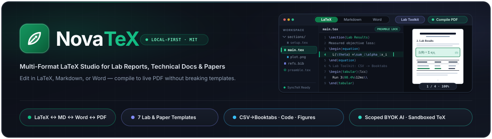
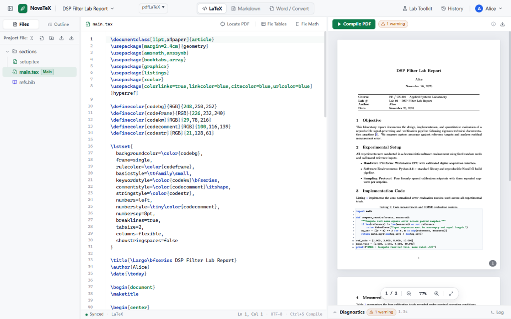
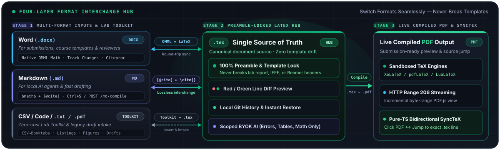
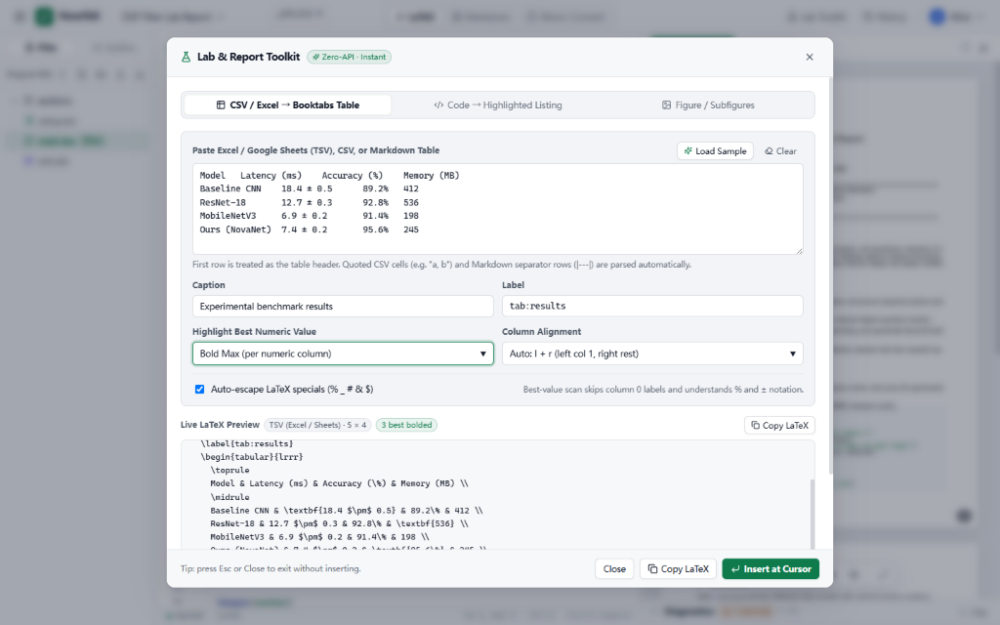
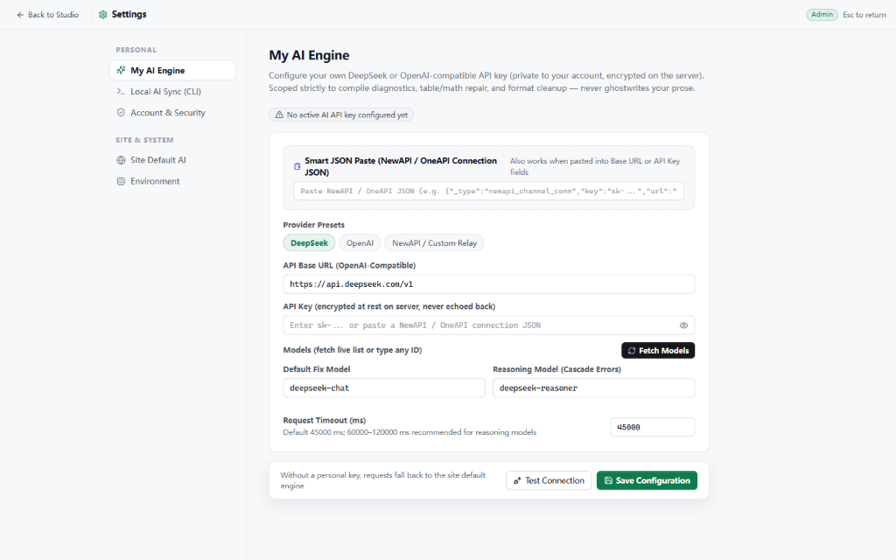
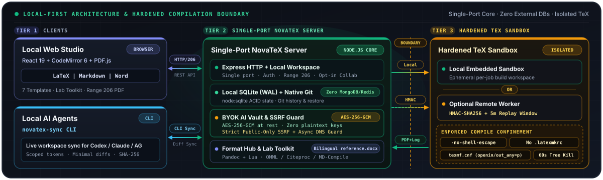

<div align="center">

<picture>
  <source media="(prefers-color-scheme: dark)" srcset="docs/images/hero-dark.svg" />
  <source media="(prefers-color-scheme: light)" srcset="docs/images/hero-light.svg" />
  
</picture>

<br />

<p>
  <a href="https://github.com/KennyMcSimpson/NovaTeX/actions/workflows/ci.yml"></a>
  = 22" />
  
  
  
  
  <a href="./LICENSE"></a>
</p>

<p>
  <strong>NovaTeX — Local-First Multi-Format LaTeX Studio for Lab Reports, Technical Docs &amp; Academic Papers.</strong><br />
  Seamless <code>LaTeX ↔ Markdown ↔ Word (.docx) ↔ TXT/PDF</code> interchange · 7 ready-to-compile templates &amp; zero-cost Lab Toolkit · Scoped BYOK AI repair · Local AI agent sync (<code>novatex-sync</code>) · Hardened TeX sandbox.
</p>

<p>
  <a href="#four-layer-format-interchange">Format Hub</a> ·
  <a href="#built-for-lab-reports-coursework--technical-docs">Lab Toolkit &amp; Templates</a> ·
  <a href="#scoped-byok-ai-repair">Scoped BYOK AI</a> ·
  <a href="#local-first-architecture--security">Architecture &amp; Security</a> ·
  <a href="#quick-start">Quick Start</a>
</p>

</div>

<p align="center">
  
  <br />
  <sub><strong>Local-First Multi-Format Studio</strong> — Engineering Lab Report beside a live compiled PDF, with nested file tree, <code>LaTeX | Markdown | Word</code> switcher, zero-cost Lab Toolkit, and native English / Chinese UI (English by default on English browsers).</sub>
</p>

---

## Why NovaTeX?

Writing a lab report, technical specification, or academic paper shouldn't force you to fight brittle LaTeX boilerplate, hand-format CSV tables into `booktabs`, or re-type documents whenever a course, professor, or reviewer asks for Word. **NovaTeX runs locally in one command** and bridges every format you and your AI coding tools actually use.

| Dimension | Cloud LaTeX Platforms | Raw Local TeX Editors | **NovaTeX** |
| :--- | :--- | :--- | :--- |
| **Multi-Format Interchange** | LaTeX-only; moving between Word, Markdown, and TeX requires tedious manual copy-paste. | Ad-hoc Pandoc commands that frequently overwrite preambles, citations, and figures. | **First-class 4-Layer Format Hub** — switch seamlessly between `LaTeX`, `Markdown`, and `Word / Convert` right beside the live compiled PDF with **100% locked LaTeX preambles**. |
| **Lab Reports & Technical Docs** | Bare templates; formatting tables, code listings, and dual subfigures from scratch takes hours. | Manual macros and external scripts for every CSV table or syntax-highlighted snippet. | **7 Ready-to-Compile Templates + Zero-Cost Lab Toolkit** — instant CSV/Excel → Booktabs three-line tables (with auto-bold best values), syntax-highlighted `listings` blocks, and figure/subfigure builders. |
| **AI & Local Agent Workflow** | Chat sidebars that rewrite prose, hallucinate numbers, or sit isolated from local coding agents. | Manual copy-paste between terminal agents and TeX files. | **Scoped BYOK AI Repair** (compile errors, tables & math only — never rewrites prose) + **`novatex-sync`** live workspace sync for Codex, Claude Code, and Antigravity. |
| **Local-First & Security** | Paid SaaS seats or heavy stacks requiring MongoDB, Redis, and multi-container orchestration. | Full host-shell exposure (`-shell-escape` / `.latexmkrc` risks) with zero guardrails. | **One-command local studio (`npm start`)** — Node 22/24 built-in `node:sqlite` (WAL) + native Git, hardened TeX sandbox (`shell: false`, `-no-shell-escape`, locked `texmf.cnf`), AES-256-GCM BYOK vault, strict SSRF/DNS guard, plus optional private self-hosting. |

---

## Four-Layer Format Interchange

<p align="center">
  <picture>
    <source media="(prefers-color-scheme: dark)" srcset="docs/images/format-hub-dark.svg" />
    <source media="(prefers-color-scheme: light)" srcset="docs/images/format-hub-light.svg" />
    
  </picture>
</p>

Switch directly in the top toolbar between **`LaTeX`**, **`Markdown`**, and **`Word / Convert`** while the right-hand **PDF.js** pane stays live via HTTP Range (`206 Partial Content`) streaming and a floating zoom / SyncTeX dock. NovaTeX keeps **`.tex` as the canonical single source of truth**, powered by Pandoc, custom Lua filters (`academic-latex.lua` & `academic-md.lua`), programmatic bilingual `reference.docx` styling, and section-level preamble-safe merging:

| Format Layer | Ideal Workflow | Native Capabilities in NovaTeX |
| :--- | :--- | :--- |
| **Word (`.docx`)** | **Course templates, professors & non-LaTeX reviewers** | Export clean, publication-styled Word with **native editable OMML equations** (`m:oMath`), `--citeproc` formatted references, embedded figures, and clean typography. Drop revised `.docx` files back (supporting Word Track Changes `accept` / `reject` / `all` and automatic figure extraction) to merge safely via red/green diff with **100% locked LaTeX preambles**. |
| **Markdown (`.md`)** | **Fast drafting & local AI coding agents** | Draft cleanly in Markdown or let local AI agents edit token-efficient `.md` files (preserving `$inline$` / `$$display$$` math, `[@cite]` keys, and `\ref` labels). Hit **`Ctrl+S`** or call **`POST /api/projects/:id/format/md-compile`** to merge cleanly back into `.tex` and compile straight into the live PDF without touching fragile LaTeX markup or preambles. |
| **LaTeX (`.tex`)** | **Final polishing & camera-ready submission** | Canonical source with CodeMirror 6 editing, `\cite`/`\ref` autocomplete, multi-file `\input` flattening & outline extraction, structured compiler diagnostics, local Git version snapshots/diff/restore, Overleaf `.zip` safe import/export, and pure-TypeScript SyncTeX v1 forward/inverse jump. |
| **Plain Text (`.txt`) & PDF Drafts** | **Word-count audits & legacy intake** | Macro-free plain-text export with accurate bilingual Latin + CJK word counting, plus lightweight `pdfjs-dist` intake to pull legacy `.txt` or `.pdf` drafts back into structured Markdown or `.tex`. |

---

## Built for Lab Reports, Coursework & Technical Docs

NovaTeX focuses on the daily pain points of students, engineers, and researchers — delivering **7 ready-to-compile templates** and a **100% deterministic, zero-API-cost Lab Toolkit** built straight into the studio.

<p align="center">
  
  <br />
  <sub><strong>Zero-Cost Lab Toolkit</strong> — Paste CSV, TSV, Excel, or Markdown tables to generate clean <code>booktabs</code> three-line LaTeX tables with automatic special-character escaping and optional best-value bolding.</sub>
</p>

### 7 Ready-to-Compile Templates

| Template | Best For | Key Pre-Configured Features |
| :--- | :--- | :--- |
| **Engineering Lab Report (EN)** | University labs & hardware/software benchmarks | Structured objectives, experimental setup, `booktabs` data tables, syntax-highlighted code listings, and figure panels. |
| **Chinese Lab Report (`ctexart`)** | Chinese coursework & lab assignments | XeLaTeX-ready `ctexart` setup with crisp CJK typography, equation numbering, and clean report headers. |
| **Technical / Project Report** | Capstone projects, design docs & engineering specs | Clean section hierarchy, executive summary, architecture figure frames, and appendix layout. |
| **Beamer Presentation Slides** | Lab demos, seminar talks & project defenses | Clean slide deck layout pre-wired for equations, bulleted highlights, figures, and result tables. |
| **Clean Academic Article** | Single-column preprints, essays & technical notes | Modern 11pt article layout with `amsmath`, `booktabs`, `graphicx`, `natbib`, and `hyperref`. |
| **IEEE Two-Column Conference** | CS, AI & engineering conference manuscripts | Standard 10pt two-column conference geometry, tight column spacing, and compact table/figure support. |
| **Chinese Academic Paper** | Chinese journal manuscripts & thesis chapters | `ctexart` academic styling pre-configured with bilingual bibliography and mathematical packages. |

### Instant Lab Toolkit (0 API Cost, Deterministic)

- **CSV / Excel → Booktabs Three-Line Table** — Paste directly from Excel (tab-separated), CSV, or Markdown tables. Auto-detects delimiters, escapes LaTeX special characters (`%`, `_`, `#`, `&`, `$`), formats `\toprule` / `\midrule` / `\bottomrule`, and optionally **auto-bolds the maximum or minimum numeric value per column**.
- **Code Snippet → Syntax-Highlighted `listings` Block** — Convert raw snippets into clean `\begin{lstlisting}` blocks with syntax styling for **Python, C++, Java, Bash, MATLAB, and SQL**.
- **Figure & Side-by-Side Subfigure Builder** — Upload images directly into `figures/` and insert single-figure floats or clean dual-panel `minipage` side-by-side layouts without memorizing float syntax.

---

## Scoped BYOK AI Repair

NovaTeX's optional AI assistant is deliberately **narrow, verifiable, and strictly BYOK (Bring Your Own Key)**: it repairs compile errors, broken tables, misaligned math, and Pandoc conversion artifacts — **and never rewrites your prose, measurements, or citations**.

<p align="center">
  
  <br />
  <sub><strong>Dedicated Full-Page Settings</strong> — Configure My AI Engine (BYOK) with encrypted at-rest keys, one-click relay JSON auto-fill, live <code>/models</code> discovery, Account &amp; Security, and Runtime Diagnostics.</sub>
</p>

- **Four Strictly Scoped Repair Modes** — `diagnose-and-fix`, `format-table`, `format-math`, and `cleanup-conversion`, backed by an anti-rewrite system prompt, an **anti-truncation safeguard** (automatically blocks outputs dropping >60% of lines), and mandatory red/green diff approval before any edit lands.
- **Whole-File Auto-Locate `Fix Tables` & `Fix Math`** — Works on an explicit selection **or** scans the entire file automatically to locate broken or unclosed table/math environments, attaches live compiler diagnostics, and performs bounded windowed splicing on long files so untouched paragraphs stay byte-for-byte identical.
- **Encrypted BYOK Vault & Relay Ergonomics** — Works with DeepSeek, OpenAI, or any OpenAI-compatible NewAPI/OneAPI endpoint (`AES-256-GCM` encrypted at rest). Features one-click JSON paste auto-fill, live `/models` picker (`POST /api/ai/models`), automatic `/v1` origin normalization, `response_format` fallback for strict relays, and reasoning-model (`deepseek-reasoner`) support.

---

## Local-First Architecture & Security

<p align="center">
  <picture>
    <source media="(prefers-color-scheme: dark)" srcset="docs/images/architecture-dark.svg" />
    <source media="(prefers-color-scheme: light)" srcset="docs/images/architecture-light.svg" />
    
  </picture>
</p>

NovaTeX is engineered **local-first** (one Node.js process, zero external database daemons) with defense-in-depth boundaries ready for both personal workstations and optional **private self-hosted Linux / cloud servers**:

- **Zero External Databases** — Single-port Express server backed by Node 22/24 built-in `node:sqlite` (WAL mode) and native Git for per-project version history. No MongoDB, Redis, or multi-container orchestration required.
- **Native Bilingual UI (`EN` / `ZH`)** — Auto-detects browser language (defaulting to **English** on English browsers), with an instant in-app language toggle and `?lang=en|zh` URL override.
- **Local AI Agent Sync (`novatex-sync`)** — Pair local coding agents (Codex, Claude Code, Antigravity) directly with your NovaTeX workspace using scoped Bearer tokens, minimal character-level diffs, strict path-safety guards, and SHA-256 echo suppression.
- **AES-256-GCM Encrypted BYOK Vault** — API keys are encrypted at rest (`enc:v1:`) using an HKDF-SHA256 key derived from `SESSION_SECRET`, held inside an unenumerable `WeakMap` vault in `@novatex/ai-fixer`, never returned over HTTP, and automatically cleared when `baseUrl` switches to a different origin.
- **Strict Public-Only SSRF & Async DNS Rebinding Guard** — Blocks loopback, RFC 1918 private LANs, CGNAT (`100.64.0.0/10`), ULA, IPv4-mapped/NAT64/6to4 IPv6, obfuscated IP notations, cloud IMDS metadata (`169.254.169.254`, `100.100.100.200`, `metadata.google.internal`), and HTTP 30x redirects (`redirect: "error"`) across config saves, `/models`, connection tests, and repair calls.
- **Hardened TeX Live Compilation Sandbox** — Enforces `shell: false`, `-no-shell-escape`, isolated per-job `texmf.cnf` (`shell_escape = f`, `shell_escape_commands = none`, `openin_any = p`, `openout_any = p`), strict child environment allowlist (stripping all server secrets), banned `.latexmkrc` / `.git` / CLI-flag filenames, `lualatex` disabled by default (`ALLOW_LUALATEX=false`), ASCII-only ephemeral staging, single-concurrency queueing, and a 60s process-tree kill timeout.
- **Optional Private Self-Hosting & Isolated `apps/worker`** — Deploy on any private server behind a TLS reverse proxy, optionally enable multi-user real-time sync via opt-in `ENABLE_COLLAB=true` (disabled by default; `ALLOW_PUBLIC_REGISTER=false`), and optionally offload TeX compilation to an isolated `apps/worker` node protected by pre-body **HMAC-SHA256** verification, a ±5-minute replay cache, and zip-slip/zip-bomb archive guards.
- **Security Policy** — See [SECURITY.md](./SECURITY.md) for the full threat model, hardening checklist, and private vulnerability disclosure process.

---

## Quick Start

### Prerequisites

- **[Node.js 22+](https://nodejs.org/)** (Node 24 recommended; uses built-in `node:sqlite`)
- **Git** (for local per-project version snapshots & restore)
- **Pandoc 2.12+ / 3.x** (required for `LaTeX ↔ Markdown ↔ Word` Format Hub conversions)
- **TinyTeX or TeX Live** (required for local PDF compilation — or run on a separate `apps/worker` node)

### Run Locally in 1 Command (Zero MongoDB / Redis)

```bash
git clone https://github.com/KennyMcSimpson/NovaTeX.git
cd NovaTeX

# 1. Install dependencies & build all workspaces + web UI
npm ci
npm run build

# 2. Create local configuration (never commit .env)
cp .env.example .env

# 3. Start NovaTeX locally on a single port
npm start
```

Open **`http://127.0.0.1:3456`** in your browser to create your local admin account via the one-time setup wizard, pick one of the **7 built-in templates**, and start writing.

### Local AI Agent Sync (`novatex-sync`) & Offline Conversion

Create a scoped personal sync token inside your workspace settings, then sync a local folder with Codex, Claude Code, or Antigravity — or run standalone offline conversions:

```bash
# Bidirectional live sync between a local folder and your NovaTeX workspace
npm run sync -- watch \
  --url http://127.0.0.1:3456 \
  --project <PROJECT_ID> \
  --token <YOUR_SYNC_TOKEN> \
  --dir ./local-report \
  --name "Local Agent"

# One-shot workspace pull (blocks path traversal, .git, and .latexmkrc)
npm run sync -- pull \
  --url http://127.0.0.1:3456 \
  --project <PROJECT_ID> \
  --token <YOUR_SYNC_TOKEN> \
  --dir ./local-report

# Standalone offline format conversions (powered by @novatex/format-hub)
npm run sync -- convert --from tex --to docx --input main.tex --output report.docx --bib refs.bib
npm run sync -- convert --from md --to tex --input draft.md --output sections/results.tex --body-only
```

### Optional: Private Self-Hosting, Opt-In Multi-User Sync & Isolated `apps/worker`

NovaTeX defaults to a lean, single-user local studio. When deploying on a private Linux/cloud server:

1. **Isolated Compile Node (optional):** On a compile host with TinyTeX/TeX Live installed, set `COMPILER_SHARED_SECRET=<strong-random-secret>` and start `npm run start:worker` (default port `3457`; refuses non-loopback bind without a shared secret).
2. **Main Server:** Set `COMPILER_MODE=remote`, `COMPILER_URL=http://<worker-host>:3457`, the matching `COMPILER_SHARED_SECRET`, `PUBLIC_ORIGIN=https://<your-domain>`, and keep `ALLOW_PUBLIC_REGISTER=false` behind Nginx or Caddy TLS.
3. **Opt-In Multi-User Real-Time Sync (optional):** Set `ENABLE_COLLAB=true` (and forward WebSocket upgrades on `/collab` in your reverse proxy) only if you explicitly want invite-based multi-user rooms on your private deployment.

---

## Testing & Verification

```bash
# Build all 8 workspaces & verify strict TypeScript types
npm run build
npm run typecheck

# Full test matrix (includes end-to-end XeLaTeX + SyncTeX + MD-compile checks)
npm test

# TeX-free CI subset (requires only Node 22+ and Pandoc)
npx vitest run packages/shared packages/compiler packages/ai-fixer packages/format-hub packages/sync-cli apps/worker
```

---

## Project Structure

```text
NovaTeX/
├── packages/
│   ├── shared/         # Domain types, path-safety guards, pure-TS line diff & minimal splices
│   ├── compiler/       # Hardened TeX Live sandbox, structured log parser, pure-TS SyncTeX v1 engine
│   ├── ai-fixer/       # Scoped BYOK repair, whole-file table/math locator, SSRF/DNS rebinding guard
│   ├── format-hub/     # 4-layer interchange (Pandoc, Lua filters, bilingual reference.docx, 7 templates, PDF intake)
│   └── sync-cli/       # Local AI agent sync CLI (`novatex-sync`) & standalone offline format converter
├── apps/
│   ├── server/         # Single-port Express + node:sqlite (WAL) + Git + PDF Range 206 + opt-in collab server
│   ├── worker/         # Optional isolated TeX compile microservice (HMAC-SHA256 + replay/zip guards)
│   └── web/            # Linear x Typst React 19 + Vite + CodeMirror 6 + PDF.js studio, Lab Toolkit & EN/ZH UI
├── docs/images/        # Adaptive dark/light SVG diagrams and pure-English studio screenshots
├── .github/workflows/  # GitHub Actions CI workflow (build, typecheck, TeX-free suite with Pandoc)
├── SECURITY.md         # Threat model, hardening checklist & private vulnerability disclosure
└── LICENSE             # MIT License
```

---

## License

Licensed under the [MIT License](./LICENSE).
